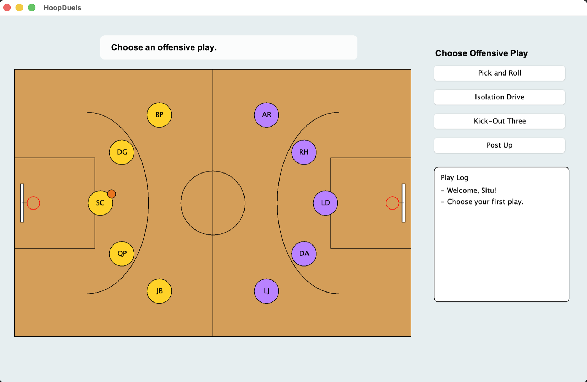
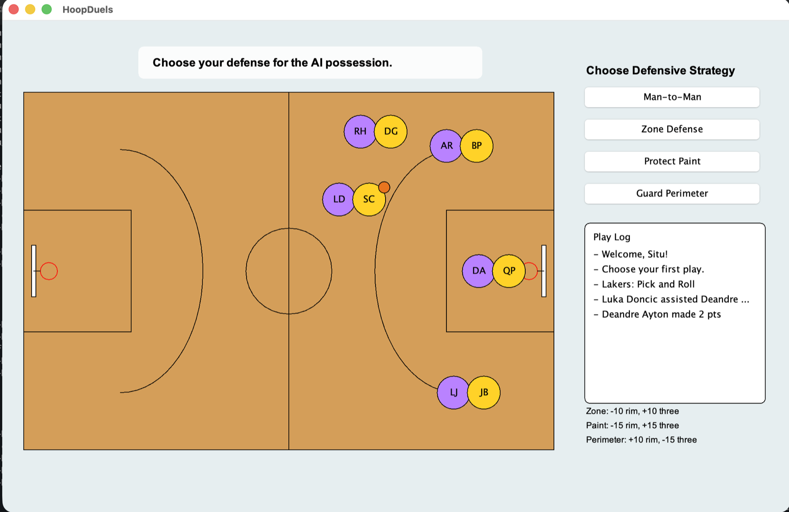

# HoopDuels

HoopDuels is a basketball game we made in Java using Swing. You are the coach of an NBA team, and you play against the computer. You pick the plays on offense and the defense on defense. Then you watch the players move on the court. The game keeps going until time runs out.

We made it for AP Computer Science A. There are three of us on the team.

## Screenshots

This is the screen where you pick a play on offense. Your team is on the left and the computer's team is on the right. The four plays are on the side panel.



This is the screen when you are on defense. The court is the same, but now the buttons show the four defenses. The notes under the play log tell you how each defense changes the other team's shots.



## What it is

You control one team against the computer, one possession at a time. On offense, you pick a play. On defense, you pick a defense that makes it harder or easier for the computer to score. After you pick, the five players move, pass, and shoot. The shot goes in or it misses. When time runs out, the team with more points wins. If the score is tied, you go to overtime.

## How to play

1. Type in your name.
2. Pick a team: Warriors, Lakers, Celtics, or Thunder.
3. Pick your five starting players.
4. Play the game. You and the computer take turns having the ball.
   - On offense, you have four plays:
     - **Pick and Roll:** A player sets a screen at the top, then the big man runs to the basket.
     - **Isolation Drive:** Everyone moves out of the way so one player can drive to the basket.
     - **Kick-Out Three:** A player drives inside, then passes back out for a three.
     - **Post Up:** Your center gets the ball close to the basket.
   - On defense, you have four choices. Each one changes how likely the computer is to make its shots:
     - **Man-to-Man:** The normal defense. Nothing changes.
     - **Zone Defense:** Stops shots near the basket, but leaves threes open.
     - **Protect Paint:** Stops shots near the basket even more, but threes get even easier.
     - **Guard Perimeter:** Stops threes, but makes it easier to drive to the basket.
5. Whether a shot goes in depends on three things: how good the shooter is at that kind of shot, your defense, and some luck. A made shot is worth 2 or 3 points. If a shot misses, someone grabs the rebound. The defense gets it about 70% of the time.
6. Each game is 12 minutes of game time, but the clock runs faster so you don't wait too long. When time runs out, the team with more points wins. If it's tied, you play overtime, and the first team to score wins.
7. After the game, you see a box score. It shows each player's points, rebounds, assists, and shooting.

A note about the computer: it starts every game with the same set of plays, and then it picks plays at random. But if it's losing with less than three minutes left, it starts shooting more threes to try to catch up.

## How to run it

You need a JDK (Java Development Kit). We used Java 17.

```bash
# from the project folder
javac *.java
java HoopDuels
```

## What's next

I have two ideas for what to add next. The first is a two-player mode, so two people can play against each other on the same keyboard. The second, which I want to do more, is to make the computer use real AI instead of the plays it follows now. I'm saving that one until I learn how to work with AI.
